<div align="center">

# SkyUI

**少一些噪音，多一些创造。**

一套面向个人创作的黑白 UI 组件库与交互式展示站。

用留白、细线和克制的层次建立统一的设计语言 —— 从一个按钮，到一整套 HTTP 状态页面。

[](https://react.dev)
[](https://www.typescriptlang.org)
[](https://vite.dev)
[](https://tailwindcss.com)
[](https://github.com/SkyBiuBiu/imskyui/releases)
[](https://github.com/SkyBiuBiu/imskyui/actions/workflows/ci.yml)
[](#许可证)

**66** 个组件与场景 · **66** 个组件与工具 · **2** 套主题 · **18** 种 HTTP 状态页面 · **0** 个组件依赖

[快速开始](#这是什么) · [组件 API](docs/components.md) · [更新日志](CHANGELOG.md) · [English](README.en.md) · [接入方式](#接入你的项目) · [本地运行](#本地运行)

</div>

---

## 这是什么

SkyUI 不是一个需要安装的组件库，而是一套**可以直接复制走**的黑白设计语言。

- **拿走即用** —— 点击「开始使用」下载 `ui.tsx` 和 `ui.css` 两个文件，扔进 React 项目就能跑，不需要装任何 npm 包。
- **不止于控件** —— 66 个组件与工具，覆盖排版、卡片、浮层、导航、表格、日期选择、命令面板与图表指标，另提供表单校验、分步表单、文件上传、数据表格、骨架屏等完整场景。
- **图表也是零依赖** —— 折线图、迷你趋势线、环形仪表、阈值水位条、数字滚动全部手写 SVG / CSS，不引入任何图表库。
- **覆盖异常路径** —— 18 种 HTTP 状态页面（200 到 504），包含带倒计时重试的 429。
- **两套主题** —— 浅色与深色通过一个 CSS class 切换，所有组件自动跟随。
- **零图片资源** —— 所有几何视觉由 CSS 绘制，首屏没有一张外部图片要加载。

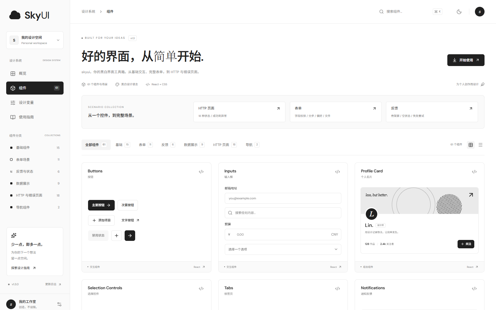

> 上图：组件画廊首屏。左侧为设计系统导航，顶部支持 `⌘K` / `Ctrl+K` 打开命令面板，
> 中部按 6 个分类（基础 / 表单 / 反馈 / 数据展示 / HTTP 页面 / 导航）筛选，支持网格与列表两种视图。

---

## 界面一览

### 概览页

设计宣言与项目统计，是进入组件库的入口页。

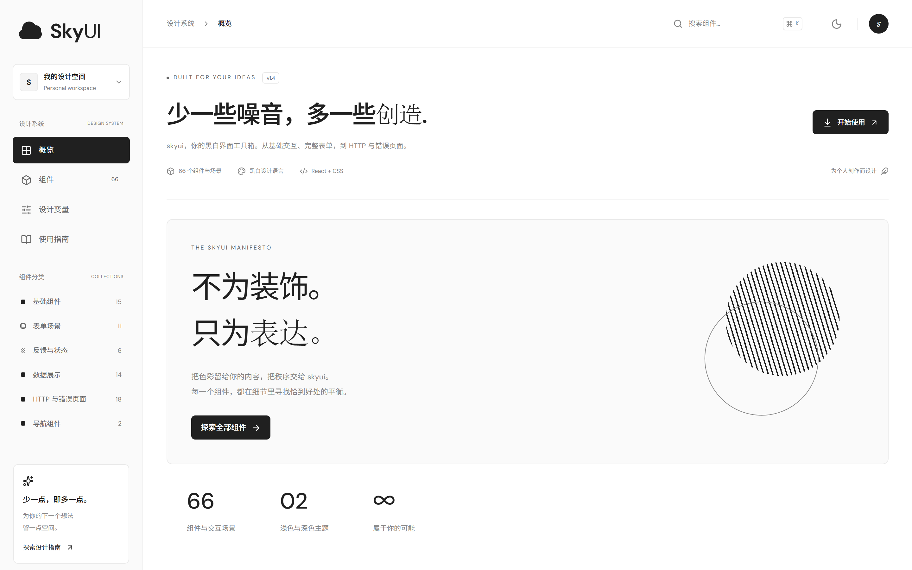

### 组件画廊 · 深色主题

右上角一键切换，所有组件与几何装饰同步反色，无需重新加载。

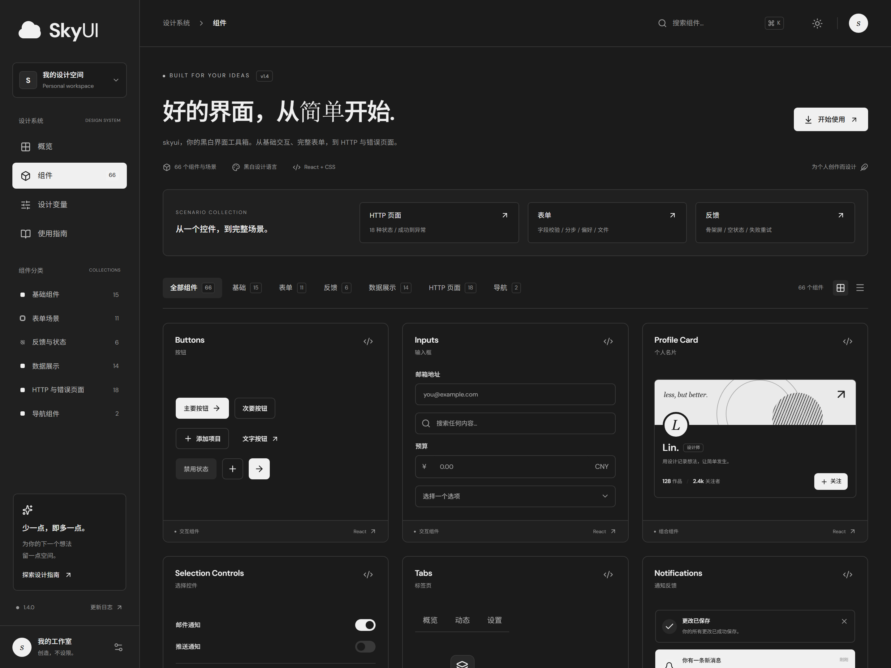

### 设计变量

色彩、圆角、间距三组变量，并支持一键导出为 JSON 设计规范。

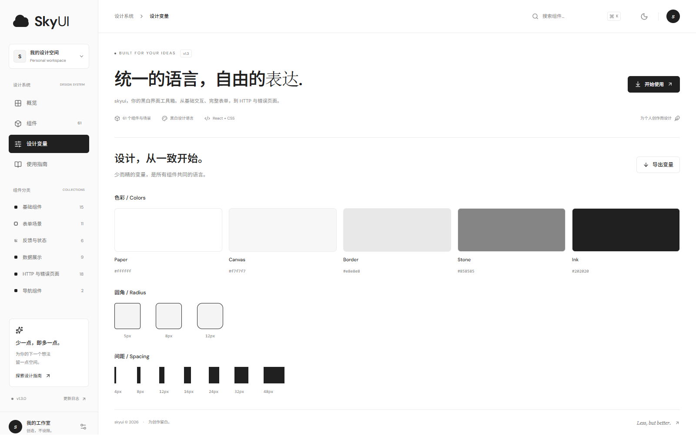

### 使用指南

三步接入流程：下载源码 → 引入组件 → 改写为你自己的设计语言。

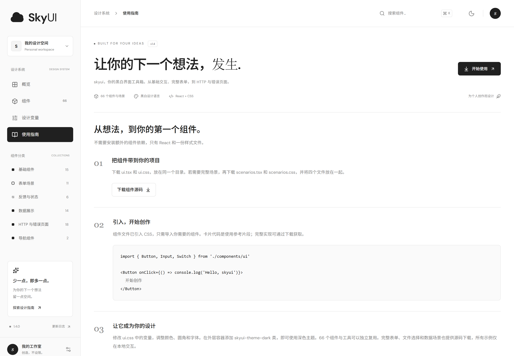

---

## 组件地图

以下按源码文件 `ui.tsx` 的导出分组，共 **66 个组件与工具**。

### 排版与容器（6）

`Title`（四级标题）、`Text`（次要 / 弱化 / 加粗 / 代码 / 标记 / 下划线 / 删除线）、`Paragraph`、`Kbd`、`Card`（标题栏 / 内容区 / 页脚）、`Label`。黑白设计语言的核心载体，所有页面元素的统一来源。

### 基础组件（12）

按钮、输入框、开关、徽标与标签、头像、复选框、下拉框、多行输入、通知条、骨架屏、空状态、HTTP 状态页面。按钮提供主要 / 次要 / 文字三种变体，以及 sm / md / lg 三档尺寸与加载态。

### 浮层组件（8）

Tooltip（纯 CSS 提示）、HoverCard（悬停卡片）、Dropdown（下拉菜单）、Popover（气泡卡片）、Modal（原生 `dialog.showModal()` 对话框）、Drawer（三向抽屉）、ToastProvider 与 useToast（命令式通知，队列 + 自动消失）。全部不依赖第三方浮层库，Escape / 遮罩可关闭，焦点自动还原。

### 选择控件（5）

Segmented（分段控件）、RadioGroup（单选组）、Toggle / ToggleGroup（双态按钮）、Rate（星级评分）。

### 导航组件（5）

标签页、折叠面板（单开 / 多开）、面包屑、分页（窗口化页码）、步骤条。

### 数据与布局（14）

进度条、滑块、头像组（+N 溢出）、可移除标签、columns 配置式数据表格（加载态 / 粘性表头 / 行展开）、统计数值、时间线、描述列表、分隔线、Stack / Container / Grid / GridItem 布局原语、Carousel 轮播。

### 表单与命令（5）

useForm 校验 hook、FormItem 表单项、Command 命令面板、Calendar 月历、DatePicker 日期选择器。

### 图表与指标（8）

Sparkline（表格行内迷你走势，无坐标轴）、LineChart（多序列折线趋势图，网格线 + 虚实图例 + 端点标注）、Gauge（环形仪表，适合占比 / 完成度）、Meter（阈值水位条，在进度条上标出分级刻度）、Counter（数字滚动，尊重 `prefers-reduced-motion`）、ThresholdLegend（阈值分级图例）、SearchInput（带清空的搜索框）、FilterChips（单选分类筛选胶囊）。

全部为手写 SVG / CSS，不引入图表库。数值超量程按比例截断而非溢出；等值序列保留上下留白，不退化成贴边直线。

### 配置与指示（3）

ConfigProvider 主题与默认尺寸注入、useSkyUIConfig 读取配置、Spin 加载指示器。

---

## 画廊 61 张卡片

展示站画廊按 6 个分类组织，共 **61** 张卡片；除分类筛选外，还支持关键词搜索、网格 / 列表两种视图。

| 分类 | 卡片数 | 内容 |
| --- | --- | --- |
| **基础** | 15 | 按钮、标签页、徽标、折叠面板、Tooltip、Dropdown、分隔线、Typography、Card、Segmented、Toggle、Popover、HoverCard、Grid、ConfigProvider |
| **表单** | 11 | 输入框、选择控件、进度与滑块、联系表单、分步表单、偏好设置、文件上传、RadioGroup、Rate、Calendar、DatePicker |
| **反馈** | 6 | 通知与 Toast、对话框、抽屉、数据三态、Spin、命令面板 |
| **数据展示** | 9 | 个人名片、数据概览、头像、数据表格、迷你表格、统计数值、时间线、描述列表、轮播 |
| **导航** | 2 | 面包屑与分页、步骤条 |
| **HTTP 页面** | 18 | 200 到 504 全部状态码 |

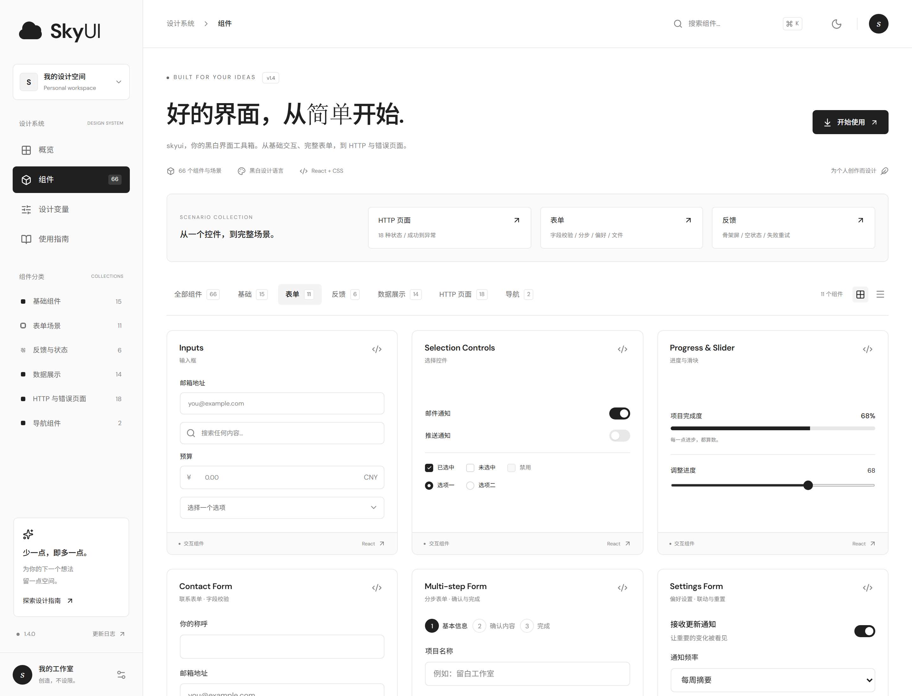

> 上图：表单分类下的 11 个场景。联系表单做了实时邮箱格式校验并把错误聚焦到字段；
> 分步表单包含基本信息的确认步骤；文件上传支持拖放，并校验类型与 5MB 大小上限。

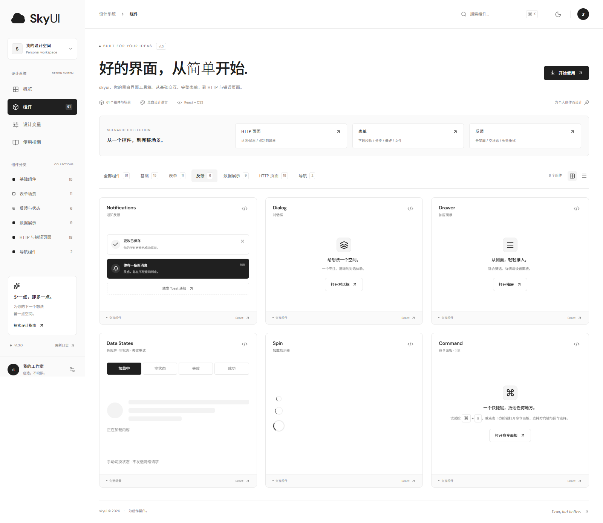

> 上图：反馈分类下的 6 个场景。Toast 走命令式队列，对话框与抽屉基于原生 `dialog` 元素，
> 数据三态在骨架屏 / 空状态 / 失败重试之间切换，命令面板支持 `⌘K` 唤起。

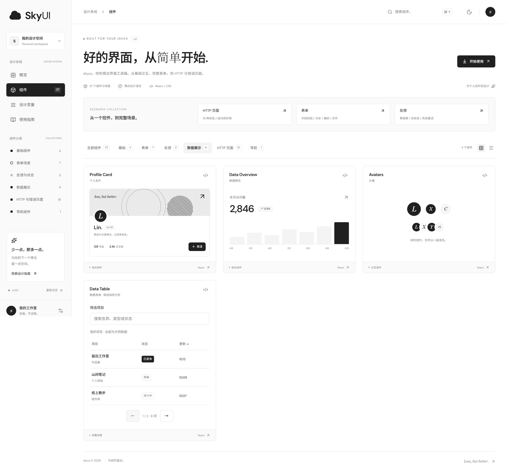

> 上图：数据展示分类下的 14 个场景。数据表格支持按标题与类型筛选、按更新时间排序，以及分页浏览；
> 迷你表格展示 Table 的紧凑形态，统计数值与时间线覆盖常用的数字呈现。

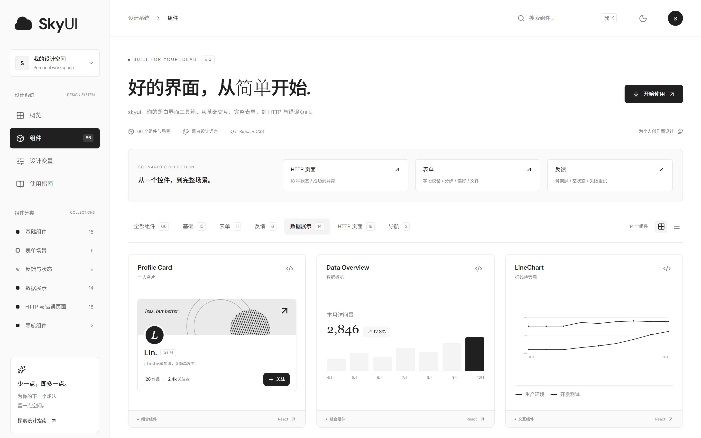

> 上图：`LineChart` 双序列对比。网格线、三档纵轴刻度与虚实图例让多条序列可以叠加阅读；
> 端点自动标注当前值，纵轴留白 12% 使等值序列也不会退化成贴边直线。

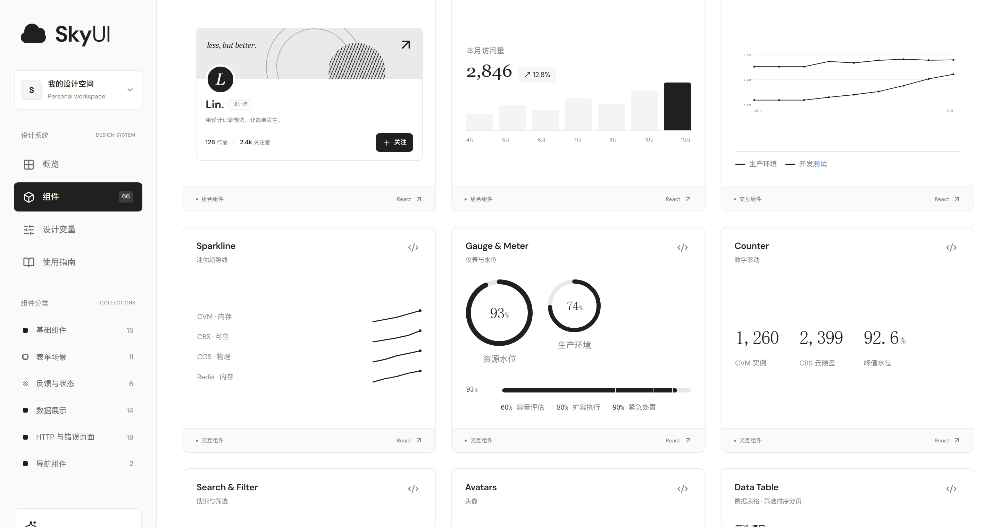

> 上图：`Gauge` 环形仪表与 `Meter` 阈值水位条。仪表适合单一占比，水位条在进度条上标出分级刻度，
> 配合 `ThresholdLegend`（60% 容量评估 / 80% 扩容执行 / 90% 紧急处置）可让阈值策略不必心算；
> 右侧 `Counter` 演示数字滚动，`Sparkline` 在表格行内嵌走势。

---

## HTTP 状态页面

18 种状态码，从成功到服务器异常全覆盖。每张卡片都能打开大尺寸预览，体验页面内的主要操作。

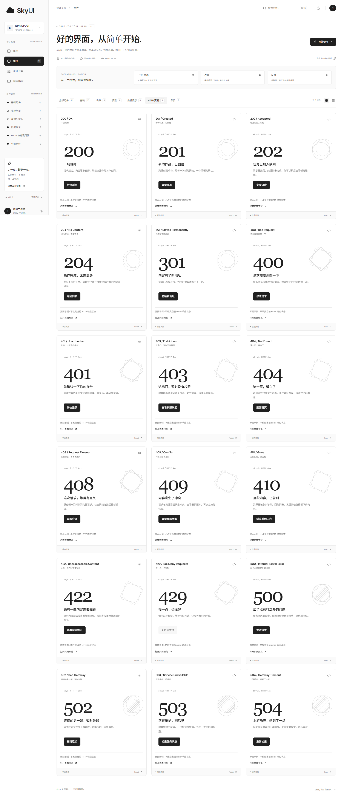

| 分类 | 状态码 |
| --- | --- |
| **成功 2xx** | 200 OK · 201 Created · 202 Accepted · 204 No Content |
| **重定向 3xx** | 301 Moved Permanently |
| **客户端错误 4xx** | 400 · 401 · 403 · 404 · 408 · 409 · 410 · 422 · 429 |
| **服务器错误 5xx** | 500 · 502 · 503 · 504 |

**大尺寸页面预览**

<table>
<tr>
<td width="50%">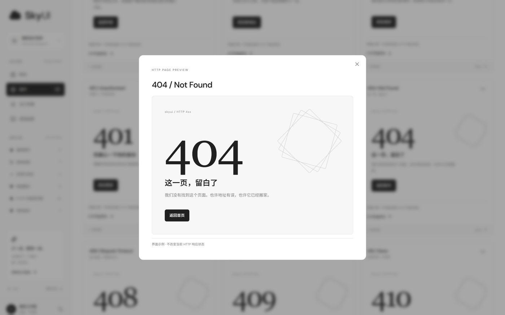</td>
<td width="50%">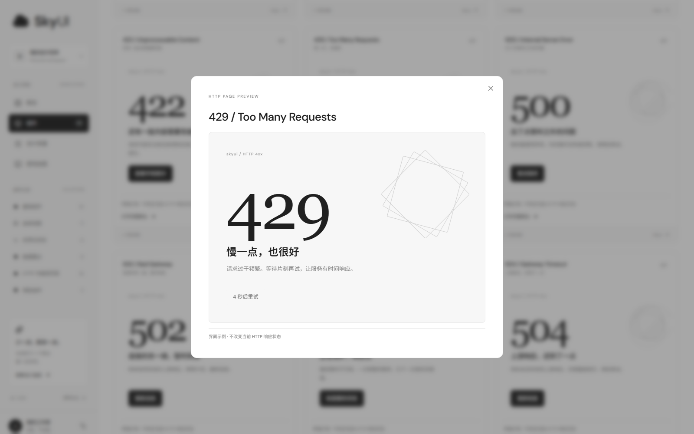</td>
</tr>
<tr>
<td align="center"><em>404 —— 提供「返回首页」操作</em></td>
<td align="center"><em>429 —— 倒计时结束后可重试</em></td>
</tr>
</table>

组件通过 `actions` 属性接收你自己的导航与重试逻辑：

```tsx
<HttpStatusPage
  code={404}
  title="这一页，留白了"
  description="我们没有找到这个页面。也许地址有误，也许它已经搬家。"
  actions={<Button onClick={() => router.navigate({ to: '/' })}>返回首页</Button>}
/>
```

> 这些卡片只是**界面示例**：不会改变服务器的真实响应状态，也不会发送任何请求。
> 204 卡片展示的是客户端收到无正文响应后的确认界面，而不是 HTTP 响应正文本身。
> 站点另外配置了路由未匹配时的真实 404 页面，以及渲染异常时的错误回退界面。

---

## 接入你的项目

不需要安装任何组件依赖，只要 **React 18+**（组件内部使用了 `useId`，演示站运行于 React 19）和一份样式文件，不需要 Lucide 图标库。

### 第 1 步：获取源码

源码文件在仓库内的固定位置：`src/components/` 下的 `ui.tsx`、`ui.css`、`scenarios.tsx`、`scenarios.css`。三种获取方式任选其一：

**方式 A：命令行直接拉取（推荐，AI 工具 / 脚本友好）**

```bash
# 只取 4 个源码文件，不带 git 历史，输出到项目的组件目录
npx degit SkyBiuBiu/imskyui/src/components src/components
```

或逐个下载基础组件的两个文件：

```bash
mkdir -p src/components
curl -fsSL -o src/components/ui.tsx  https://raw.githubusercontent.com/SkyBiuBiu/imskyui/main/src/components/ui.tsx
curl -fsSL -o src/components/ui.css  https://raw.githubusercontent.com/SkyBiuBiu/imskyui/main/src/components/ui.css
```

> `-fsSL`：静默下载，失败时返回非零退出码，方便脚本判断。
> 锁定版本时，把 URL 中的 `main` 换成对应的 Release tag 即可。

**方式 B：展示站下载**

点击页面右上角的 **开始使用**，下载 `ui.tsx` 和 `ui.css`，放进同一个目录。

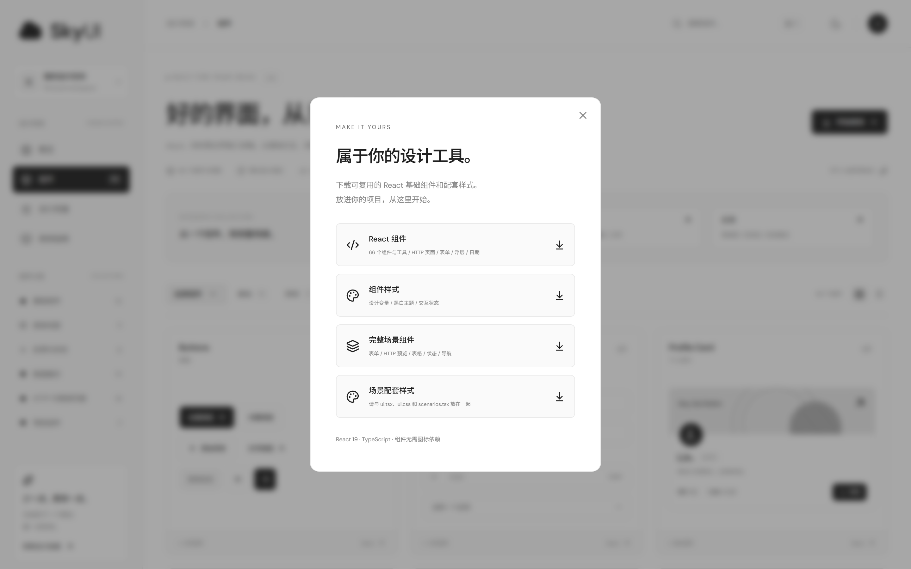

**方式 C：克隆整个仓库**

```bash
git clone https://github.com/SkyBiuBiu/imskyui.git
# 源码位于 imskyui/src/components/
```

> 基础组件只需 `ui.tsx` + `ui.css` 两个文件。
> 需要完整场景（表单、表格、状态、导航）时，再下载 `scenarios.tsx` 和 `scenarios.css`，
> 四个文件放在同一目录。

### 第 2 步：引入组件

```tsx
import { Button, Input, Switch, Badge, Avatar, HttpStatusPage } from './components/ui'

<Button>开始创作</Button>
```

> 每个组件的完整 props 说明见 **[组件 API 参考](docs/components.md)**。

66 个组件与工具可以独立复用，且**不需要 Lucide 图标库**：

- **排版与容器**：`Title` · `Text` · `Paragraph` · `Kbd` · `Card` · `Label`
- **基础**：`Button` · `Input` · `Switch` · `Badge` · `Avatar` · `Checkbox` · `Select` · `Textarea` · `Alert` · `Skeleton` · `EmptyState` · `HttpStatusPage`
- **浮层**：`Tooltip` · `HoverCard` · `Dropdown` · `Popover` · `Modal` · `Drawer` · `ToastProvider` · `useToast`
- **选择**：`Segmented` · `RadioGroup` · `Toggle` · `ToggleGroup` · `Rate`
- **导航**：`Tabs` · `Accordion` · `Breadcrumb` · `Pagination` · `Steps`
- **数据与布局**：`Progress` · `Slider` · `AvatarGroup` · `Tag` · `Table` · `Statistic` · `Timeline` · `Descriptions` · `Divider` · `Stack` · `Container` · `Grid` · `GridItem` · `Carousel`
- **表单与命令**：`useForm` · `FormItem` · `Command` · `Calendar` · `DatePicker`
- **配置**：`ConfigProvider` · `useSkyUIConfig` · `Spin`

需要完整场景时：

```tsx
import { ContactFormDemo, DataTableDemo, DataStatesDemo } from './components/scenarios'

<ContactFormDemo />
```

`scenarios.tsx` 另提供 `MultiStepFormDemo`、`SettingsFormDemo`、`UploadFieldDemo`、`NavigationDemo`、`HttpDemo` 与 `httpScenarios`。

### 第 3 步：改成你自己的设计

修改 `ui.css` 中的 `--skyui-*` 变量调整色彩、圆角和间距；在外层容器加 `skyui-theme-dark` 类即可启用深色主题。

所有下载内容都通过 Vite `?raw` 导出真实源码，**下载到的代码和仓库里的实现永远一致**。卡片上的代码预览是精简的使用参考，不是完整实现。

---

## 设计变量

| 类型 | 取值 |
| --- | --- |
| **色彩** | Paper `#ffffff` · Canvas `#f7f7f7` · Border `#e8e8e8` · Stone `#858585` · Ink `#202020` |
| **圆角** | 5px · 8px · 12px |
| **间距** | 4 · 8 · 12 · 16 · 24 · 32 · 48 |

设计变量页支持一键导出 JSON 格式的设计规范，方便交给其他工具继续使用。

---

## 响应式

侧边栏在窄屏下收起为抽屉式导航，画廊与表单场景保持单列可读。

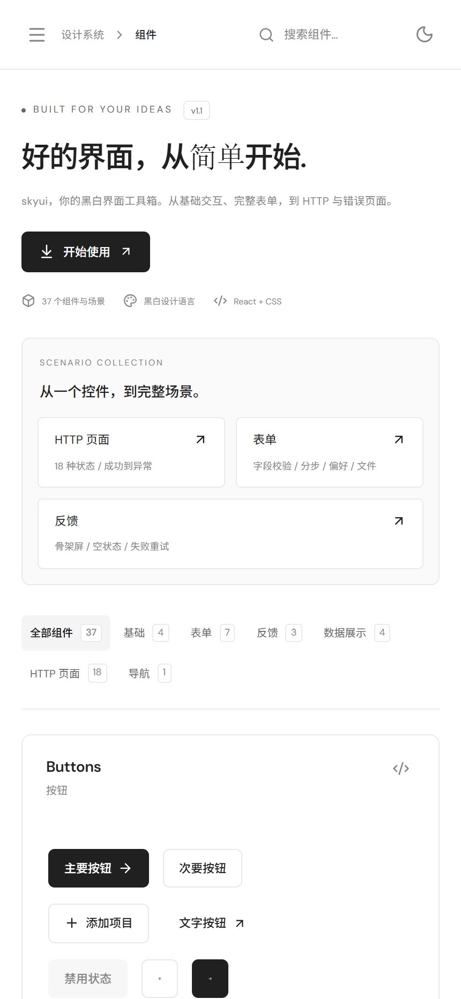

---

## 技术栈

React 19 · TypeScript · TanStack Start / Router · Vite 7 · Tailwind CSS 4 · Lucide 图标（仅展示站）

页面主要使用自定义 CSS，几何视觉全部由 CSS 绘制，不依赖图片资源。对话框使用原生 `dialog.showModal()`，自带焦点限制、Escape 关闭与焦点还原。

---

## 本地运行

需要 **Node.js 22+** 和 **pnpm**。

```bash
# 安装依赖
pnpm install

# 启动开发服务器
pnpm dev
```

默认开发地址为 `http://localhost:3000`。

| 命令 | 说明 |
| --- | --- |
| `pnpm dev` | 启动 Vite 开发服务器（端口 3000） |
| `pnpm typecheck` | TypeScript 类型检查 |
| `pnpm test` | vitest 单元测试 |
| `pnpm build` | 生产构建（生成 `routeTree.gen.ts`，类型检查依赖它） |
| `pnpm capture` | 按 README 示意图清单批量重截 `docs/images/`（Playwright） |
| `pnpm release:check` | 发版前全量校验（版本一致性 + 类型 + 测试 + 构建） |
| `pnpm release` | 一键发版：校验 → 打 annotated tag → 创建 GitHub Release |

版本号遵循 SemVer，且只存在于 `package.json` 与 `src/version.ts` 两处，由 `pnpm check:version` 强制同步 —— CI 会在每次 push 与 PR 时运行构建、类型检查、测试与版本一致性校验，版本号漂移无法合入。

提交与发版约定见 [CONTRIBUTING.md](CONTRIBUTING.md)，历史版本见 [CHANGELOG.md](CHANGELOG.md)。

构建产物为 `dist/client`（客户端）与 `dist/server`（SSR），平台中立 —— Vercel、Cloudflare、Netlify 或自建 Node 服务器均可接入。

---

## 说明与边界

这是一套面向个人创作的设计系统展示，请留意它的边界：

- 所有展示数据都是**示例**。名片、访问量、订单等统计数字不是真实用户数据。
- 表单只做**本地校验**，不会发送邮件或提交到服务器；接入自己的项目时需另外实现真实提交逻辑。
- 文件选择**只读取**文件名、大小和类型，不读取文件内容，也不上传。
- 主题、开关、关注、表单和设置等交互只作用于**当前会话**，不做持久化写入。
- 项目中没有数据库、用户认证或服务端 API。

---

## 许可证

[MIT](LICENSE) —— 可以自由复制、修改、商用，保留版权声明即可。

---

<div align="center">

**Less, but better.**

</div>